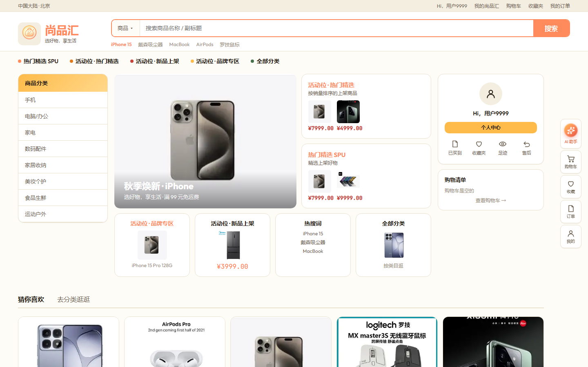
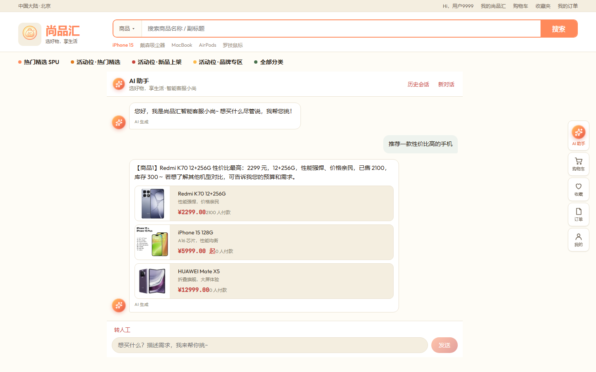
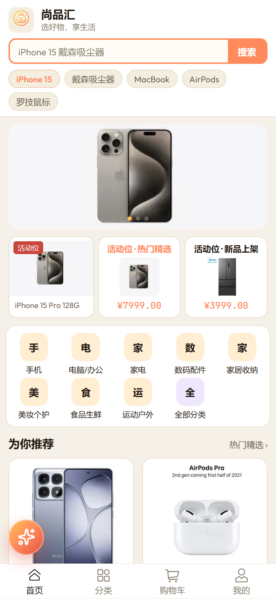
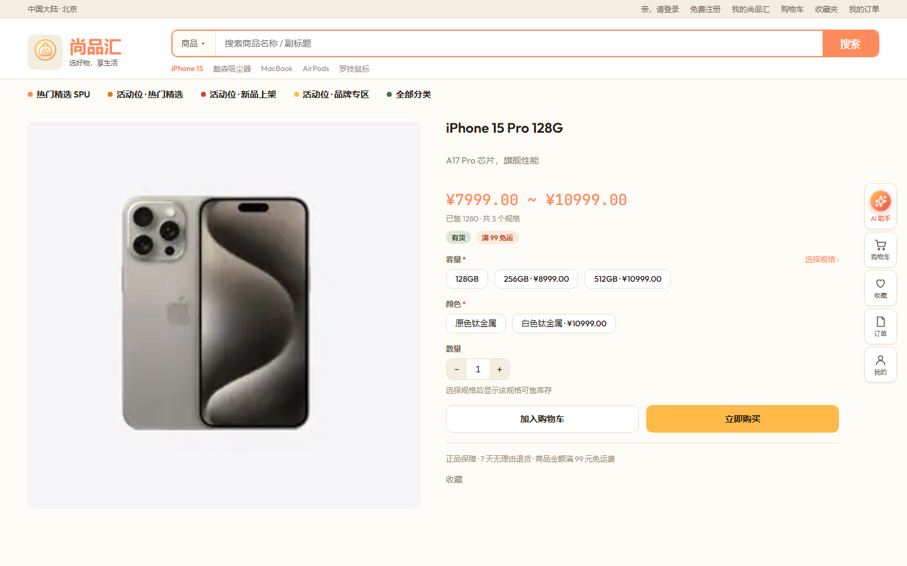
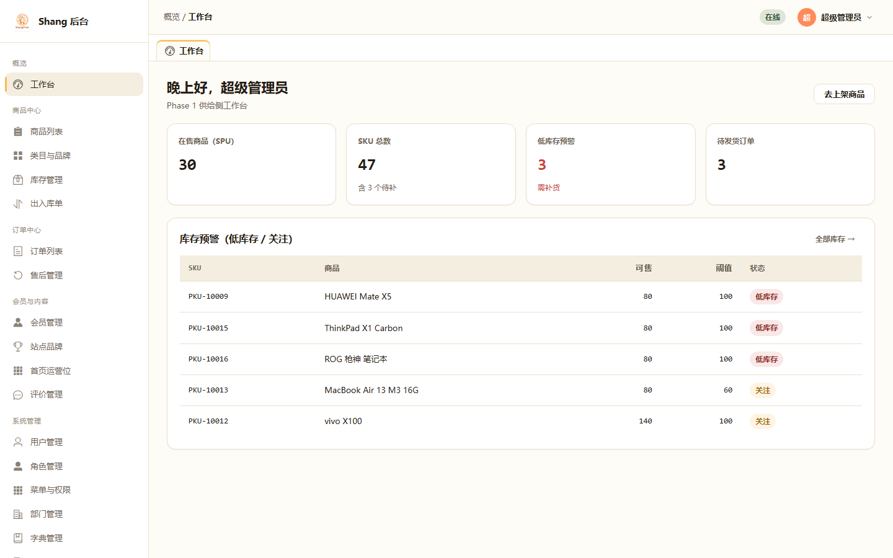
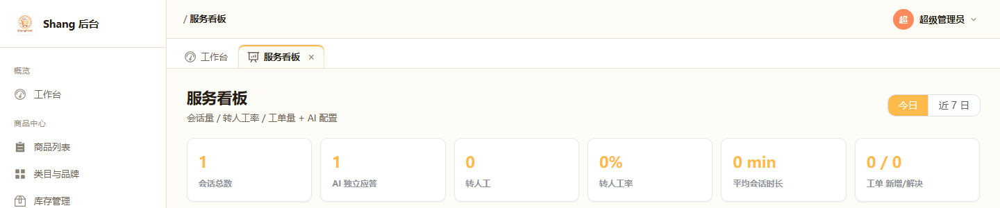

# Shang Pivot

> 一个**分版本演进的电商全栈演示项目**：后台供给（V1）→ C 端交易（V2）→ 智能客服（V3，已交付）。
> 工程 / 后台名 **Shang Pivot**，C 端品牌 **尚品汇**（Slogan：选好物，享生活）。

[](https://github.com/Inventionyin/shang-pivot/actions/workflows/ci.yml)
[](https://github.com/Inventionyin/shang-pivot/actions/workflows/e2e.yml)
[](https://github.com/Inventionyin/shang-pivot/actions/workflows/eval.yml)
[](LICENSE)

**在线体验**：商城 <https://shang.bettery.cn>（手机号 `13900009999`，验证码 `123456`）· 管理端 <https://admin.bettery.cn>（`admin` / `Admin@123`）
**仓库**：[GitHub](https://github.com/Inventionyin/shang-pivot) · [Gitee 镜像](https://gitee.com/inventionyin/shang-pivot)

**English**: A versioned full-stack e-commerce demo — admin console (V1), storefront (V2), and an AI customer-service assistant (V3) with streaming chat, RAG retrieval (pgvector), in-chat add-to-cart tools, human handoff, guardrails, and a golden-dataset evaluation harness. Java 21 / Spring Boot 4 / Vue 3 / PostgreSQL + pgvector.

`Java 21` · `Spring Boot 4.1.1` · `PostgreSQL 16 + pgvector` · `Redis 7` · `MinIO` · `Vue 3` · `Vite` · `TypeScript`

---

## 界面预览

| 商城首页（Web） | AI 导购对话（真实商品卡片） |
|---|---|
|  |  |

| 商城首页（H5，左下角 AI 球） | 商品详情 |
|---|---|
|  |  |

| 管理端工作台 | 智能客服 · 服务看板 |
|---|---|
|  |  |

---

## 目录

- [界面预览](#界面预览)
- [项目定位](#项目定位)
- [功能特性](#功能特性)
- [技术栈](#技术栈)
- [目录结构](#目录结构)
- [快速开始](#快速开始)
- [数据库与演示数据](#数据库与演示数据)
- [架构说明](#架构说明)
- [API 文档](#api-文档)
- [文档导航](#文档导航)
- [开发规范](#开发规范)
- [常见问题](#常见问题)
- [版本规划](#版本规划)
- [许可证](#许可证)

---

## 项目定位

| 项 | 说明 |
|---|---|
| 定位 | 高仿真电商演示项目：后台供给 + C 端交易 +（后续）智能客服 |
| 目标 | 闭环可演示、分版本可验收、架构可演进（模块化单体） |
| 策略 | **供给 → 交易 → 服务**：V1 做供给，V2 做交易，V3 客服依赖交易数据 |
| 不做 | 真实支付清结算、真高并发多机房、自训大模型 |

项目的核心特点是**版本纪律**：每个版本自包含、时间线单向（V1 文档不含 V2 内容），产物（原型、截图、种子数据）必须能演示该版本宣称的功能。详见 [`docs/00-product/roadmap.md`](docs/00-product/roadmap.md)。

---

## 功能特性

### V1.0 后台管理（已交付）

- **RBAC 权限**：用户、角色、部门、菜单、权限按钮、数据字典
- **商品域**：类目树、品牌、属性、SPU / SKU 多规格
- **库存域**：三态库存（物理 / 锁定 / 可售）+ 两档预警阈值、出入库单
- **交易域**：订单列表与筛选、发货出库、售后审核
- **内容与配置**：站点品牌、首页运营位、交易配置（KV）、定时上架
- **基础设施**：MinIO 文件上传、操作日志审计、工作台看板
- **演示数据**：8 个一级类目 · 8 个品牌 · 32 个 SPU（在售 30 + 草稿 1 + 下架 1）· 47 个 SKU

### V2.0 商城 C 端（已交付）

- **浏览**：首页运营位、分类、商品详情、搜索
- **交易闭环**：购物车 → 结算 → 沙箱支付 → 订单 → 确认收货
- **售后与评价**：售后申请 / 详情 / 列表、商品评价
- **会员中心**：短信登录（JWT）、收货地址、收藏、浏览足迹、个人设置
- **后台增量**：订单列表增强、会员冻结、评价管理、出入库单、定时上架、站点品牌与运营位配置

> V2.0 对 V1.0 的改动仅三处：订单列表（筛选与导出增强）、商品编辑（上架方式）、系统设置（新增交易分组），其余 V1 页面零改动。

### V3.0 智能客服（已交付）

- **AI 导购对话**：SSE 流式（思考流/正文分轨）、多轮上下文与指代解析、防幻觉约束（推荐只来自真实检索结果）
- **工具集**：商品检索（bge-m3 向量 + 词法自动降级）、SKU 规格与库存、订单/物流查询、**对话内加购**
- **转人工与运营**：坐席工作台（接入/回复/转接/结束）、客服工单、知识库（切片+向量化重建）、快捷回复、服务看板
- **安全护栏**：用户级对话限流、会话生成互斥、邮箱验证码防爆破、PII 掩码、注入检测、AI 生成标识、全量审计
- **评估层**：200 条 Golden 业务用例（20 核心 + 180 扩容，覆盖 30 个在售 SPU 实价/规格/库存、知识政策、订单/转人工、安全对抗、多轮/预算）+ 确定性断言（零 LLM 成本）+ GEval-lite 裁判，`mvn test -Peval` 或每周 CI 自动运行（本地 graph/legacy 各 200/200，生产历史 100/100；裁判均分 ~0.98 作为趋势信号）；另有 823 条夜间全量回归（API + UI 双浏览器，0 失败）与 74 条 e2e 浏览器用例
- 设计主源见 [`docs/03-ai/customer-service-智能客服.md`](docs/03-ai/customer-service-智能客服.md)

### V3.1 Agent 运行时（已上线：2026-11-07 起生产 `AGENT_ENGINE=graph`）

- **Supervisor + 4 个 LLM 子 Agent + Handoff 策略**：导购 / 订单 / 售后 / 知识四个角色，转人工是规则节点，不额外调一次模型
- **Tool Gateway**：工具契约、子 Agent 白名单、必填参数、读 1s/写 3s 超时、幂等键、`tool_call` 留痕；模型不能拼 SQL / 任意发 HTTP
- **写操作风险分级**：加购低风险直执行；取消订单 / 确认收货 / 售后走 `pending_action` + 用户确认 + CAS + 幂等，确认前不写
- **Trace**：`agent_run / agent_step / llm_call / tool_call / retrieval / guardrail_event` 落 PostgreSQL；管理端「Agent 轨迹」可查步骤、模型、工具、检索与 token
- **评测**：200 条 Golden（本地 graph/legacy 各 200/200；生产历史 100/100）+ 10/10 写操作安全矩阵（`AgentWriteSafetyIntegrationTest`）+ 8 条图编排集成测试（真实 PG + mock commerce/LLM）；周度 CI 已切 `AGENT_ENGINE=graph`
- **开关**：`AGENT_ENGINE=legacy|graph`（代码默认 `legacy`，生产已设 `graph`）；回滚只需改回 `legacy`
- 设计与取舍见 [ADR-0007](docs/04-architecture/adr/0007-agent-runtime.md)、[ADR-0008](docs/04-architecture/adr/0008-write-confirmation-idempotency.md)、[方案对比备忘](docs/03-ai/agent/README.md)

### V3.7 多轮澄清与答案质量（已上线：2026-11-11 起）

- **话轮承接**：助手问过“请回复序号/哪一款/多个规格”后，用户只回 `1`、`第一个`、`选2`、`确认`、`好的` 也能继续同一商品/规格，不再重置为欢迎语
- **指代容错**：“确认 就买这个”“就买这个吧”“好的，就要这个”等口语组合可解析；单候选直接是/否确认；目录外商品不再拿无关卡片凑数
- **回答一致性**：AnswerGuard 新增“有卡片却说没有商品”“未加购却说已加购”拦截
- **质量闭环**：每条 AI 回答可点赞/点踩（6 类原因）→ 管理端「答案质量」看板 → 差评 trace 挖掘 → `conversation-repair` 40 条回归集（CI 每次跑）

---

## 技术栈

| 层 | 技术 |
|---|---|
| 后端 | Java 21 · Spring Boot 4.1.1 · MyBatis-Plus 3.5.17 · Flyway · Lombok · Hutool |
| Agent 运行时 | Spring AI 2.0.2（模型抽象/观测）· LangGraph4j 1.9.8（状态图/检查点）· 自研 Tool Gateway |
| 数据库 | PostgreSQL 16（`pgvector/pgvector:pg16`）· Redis 7 |
| 对象存储 | MinIO（S3 兼容） |
| 鉴权 | JWT 双令牌（access + refresh），`clientType` 区分管理端 / C 端登录态 |
| API 文档 | springdoc-openapi + Knife4j（`/doc.html`） |
| 管理端前端 | Vue 3 · Vite · TypeScript · Pinia · Vue Router · Element Plus |
| C 端前端 | Vue 3 · Vite · TypeScript · Pinia · Vue Router · Vant 4 |
| 前端质量工具 | Vitest · Cypress · ESLint · oxlint · Prettier（管理端） |
| 运行时要求 | JDK 21 · Node `^22.18.0` 或 `>=24.12.0` · Docker |

---

## 目录结构

```
shang-pivot/
├── backend/                      # Spring Boot 后端（Maven 多模块，模块化单体）
│   ├── shang-common/             # 公共层：统一响应体、工具、安全、OSS、审计切面
│   ├── shang-identity-api/       # 身份上下文对外契约（供其它模块依赖）
│   ├── shang-identity/           # 身份上下文实现：RBAC、配置、文件、操作日志
│   ├── shang-commerce-api/       # 交易上下文对外契约
│   ├── shang-commerce/           # 交易上下文实现：商品、库存、订单、售后
│   ├── shang-customerservice/    # 智能客服：SSE 对话 / RAG / 工具 / 转人工 / 评估
│   ├── shang-server/             # 启动模块 + Flyway 迁移脚本（db/migration）
│   ├── docker-compose.yml        # 一键起 PostgreSQL / Redis / MinIO
│   └── .env.example              # 环境变量模板（复制为 .env 使用）
├── shang-admin-web/              # 管理端前端（Vue 3 + Element Plus）
├── shang-mall/                   # 商城 C 端（Vue 3 + Vant，Web / H5 自适应）
├── docs/                         # 产品文档唯一正文（见下方「文档导航」）
├── .stitch/                      # 设计系统 DESIGN.md + 静态原型 HTML + 截图脚本
└── AGENT.md                      # 从需求到实现的开发流水线规范
```

---

## 快速开始

### 1. 获取代码

```bash
git clone https://github.com/Inventionyin/shang-pivot.git
# 国内网络可用 Gitee 镜像：git clone https://gitee.com/inventionyin/shang-pivot.git
cd shang-pivot
```

### 2. 环境准备

需要 JDK 21、Node `^22.18.0` 或 `>=24.12.0`、Docker。Maven 无需单独安装，仓库自带 wrapper（`backend/mvnw`）。

### 3. 启动基础设施

```bash
cd backend
cp .env.example .env
docker compose up -d
```

会启动 PostgreSQL（含 pgvector）、Redis、RabbitMQ、MinIO，并把 `docs/05-assets/product/` 下的演示商品图自动灌入 MinIO 桶（`shang-pivot`）。

> MinIO 官方 Docker 镜像已下架，compose 使用社区维护的同源镜像 `pgsty/minio` / `pgsty/mc`。

### 4. 启动后端

```bash
cd backend
export JAVA_HOME=$(/usr/libexec/java_home -v 21)   # macOS；Linux 自行指定 JDK 21
./mvnw -pl shang-server -am spring-boot:run
```

首次启动 Flyway 会自动建表并灌入演示数据。后端会读取 `backend/.env`（`spring.config.import`）。

### 5. 启动管理端

```bash
cd shang-admin-web
npm install
npm run dev -- --host 127.0.0.1 --port 5173
```

### 6. 启动商城 C 端

```bash
cd shang-mall
npm install
npm run dev
```

### 7. 访问地址与演示账号

| 入口 | 地址 |
|---|---|
| 管理端 | http://127.0.0.1:5173 |
| 商城 C 端 | http://127.0.0.1:5174 |
| API 文档（Knife4j） | http://localhost:8086/doc.html |
| Swagger UI | http://localhost:8086/swagger-ui.html |
| MinIO 控制台 | http://localhost:9001 |

| 账号 | 值 |
|---|---|
| 超级管理员 | `admin` / `Admin@123` |
| 商城会员（沙箱验证码） | `13900009999` / `123456` |

> **AI 导购**需要 LLM：在 `backend/.env` 填写 `LLM_BASE_URL` / `LLM_API_KEY` / `LLM_MODEL`（任意 OpenAI 兼容网关），或启动后在管理端「服务看板 → AI 配置」填写并点「连通性测试」。未配置时对话自动降级为 FAQ + 词法推荐，不影响其他功能。

**验活**：登录管理端看到工作台，并成功上传一张图片。更多排障见 [`backend/HELP.md`](backend/HELP.md) 与 [`docs/开发与运维.md`](docs/开发与运维.md)。

---

## 数据库与演示数据

- **迁移工具**：Flyway，脚本位于 `backend/shang-server/src/main/resources/db/migration/`，共 23 个版本（V3.0 为 V22–V23）。
- **版本冻结规则**：`V1`～`V7` 为 V1.0 基线，已冻结不可修改；`V8` 起为 V2.0 增量；已应用的脚本**禁止改动内容**，修数据一律用新版本脚本前向修复。
- **空库启动即可看到完整演示数据**：32 个商品（含 1 草稿 1 下架）、47 个 SKU、3 行低库存预警、6 笔演示订单、1 张待审核售后单、7 个会员。
- **恢复现场**：删库重建即可（仅限本地演示库）。

```bash
# 本地重置演示库
cd backend
docker compose down -v && docker compose up -d
```

---

## 架构说明

采用**模块化单体（Modular Monolith）**：一个部署单元，内部按限界上下文划分 Maven 模块。

| 模块 | 职责 |
|---|---|
| `shang-common` | 统一响应体 `{ code, msg, data, traceId }`、工具类、安全、OSS 客户端、审计切面 |
| `shang-identity` | 身份上下文：RBAC、系统配置、文件管理、操作日志 |
| `shang-commerce` | 交易上下文：类目 / 品牌 / 商品 / SKU / 库存 / 订单 / 售后 |
| `shang-customerservice` | 智能客服：对话编排、LangGraph4j 图运行时、Tool Gateway、检索、转人工、工单、Trace、看板、评估 |
| `shang-server` | 应用启动、Flyway 迁移、跨模块装配 |

**依赖规则（红线）**：模块实现之间**禁止互相依赖**；跨上下文调用只能通过 `*-api` 模块暴露的接口。这条规则是保持模块边界可演进的关键。

**架构决策记录**：

- [ADR-0001 模块化单体与限界上下文](docs/04-architecture/adr/0001-模块化单体与限界上下文.md)
- [ADR-0002 技术栈选型](docs/04-architecture/adr/0002-技术栈选型.md)
- [ADR-0003 RBAC 单表与鉴权职责](docs/04-architecture/adr/0003-RBAC单表与鉴权职责.md)
- [ADR-0004 Maven 多模块模块化单体](docs/04-architecture/adr/0004-Maven多模块模块化单体.md)
- [ADR-0005 LLM 网关与两阶段编排](docs/04-architecture/adr/0005-LLM网关与两阶段编排.md)
- [ADR-0006 检索降级策略](docs/04-architecture/adr/0006-检索降级策略.md)
- [ADR-0007 Agent 运行时（Spring AI + LangGraph4j）](docs/04-architecture/adr/0007-agent-runtime.md)
- [ADR-0008 写操作确认与幂等](docs/04-architecture/adr/0008-write-confirmation-idempotency.md)

**接口分层**：管理端接口统一在 `/admin/**` 命名空间，C 端接口在 `/api/**`。

---

## API 文档

后端启动后访问 **http://localhost:8086/doc.html**（Knife4j 中文界面）。

管理端接口示例：`/admin/auth`、`/admin/products`、`/admin/stocks`、`/admin/orders`、`/admin/after-sales`、`/admin/system-configs` 等。
C 端接口示例：`/api/auth/*`、`/api/home`、`/api/products`、`/api/cart`、`/api/addresses`、`/api/site/brand` 等。

接口契约的正式定义见 [`docs/04-architecture/v1.0/接口设计.md`](docs/04-architecture/v1.0/接口设计.md) 与 [`v2.0/接口设计.md`](docs/04-architecture/v2.0/接口设计.md)。

---

## 文档导航

`docs/` 是产品文档的**唯一正文**，不同问题看不同文件：

| 你要… | 打开 |
|---|---|
| 术语 / 统一语言 | [`docs/UBIQUITOUS_LANGUAGE.md`](docs/UBIQUITOUS_LANGUAGE.md) |
| 产品与版本规划 | [`docs/00-product/roadmap.md`](docs/00-product/roadmap.md) |
| V1.0 需求与验收 | [`docs/01-requirements/PRD-V1.0-后台管理.md`](docs/01-requirements/PRD-V1.0-后台管理.md) |
| V2.0 需求与验收 | [`docs/01-requirements/PRD-V2.0-购物网站.md`](docs/01-requirements/PRD-V2.0-购物网站.md) |
| 长什么样（设计系统） | [`docs/02-design/设计系统.md`](docs/02-design/设计系统.md) |
| 怎么实现（V1 / V2） | [`docs/04-architecture/v1.0/`](docs/04-architecture/v1.0/) · [`v2.0/`](docs/04-architecture/v2.0/) |
| 启动 / 编码 / 排障 | [`docs/开发与运维.md`](docs/开发与运维.md) |
| 文档总索引 | [`docs/README.md`](docs/README.md) |
| 开发流水线规范 | [`AGENT.md`](AGENT.md) |

设计系统与静态原型在 [`.stitch/`](.stitch/)：`DESIGN.md` 是所有页面的设计契约，`原型/` 下的纯静态 HTML 是交互规格（**原型是规格，实现必须与它一致**）。改完原型可一键重渲全部截图：

```bash
node .stitch/原型/render-shots.mjs                # 全量（44 张，写入 docs/01-requirements/shots/）
node .stitch/原型/render-shots.mjs --only=orders  # 只渲匹配的文件名
```

---

## 开发规范

几条容易踩的红线（完整规范见 [`docs/开发与运维.md`](docs/开发与运维.md) §3）：

| 规矩 | 说明 |
|---|---|
| 模块依赖 | 实现互禁依赖，跨上下文只走 `*-api` |
| Flyway | 已应用的迁移脚本禁止改内容，只能追加新版本 |
| 统一响应 | `{ code, msg, data, traceId }`，Long 序列化为字符串 |
| 库存约束 | `physical ≥ locked ≥ 0`，可售 = 物理 − 锁定（不落库） |
| 审计 | 关键写操作打 `@OpLog` |
| 命名 | 菜单名 = 页面标题，不造同义词；术语以统一语言文档为准 |
| 版本纪律 | 不把后续版本的概念写进当前版本（代码里的 Tab 与占位入口同理） |
| 密钥 | `.env` 绝不入库；模板见 `backend/.env.example` |
| 日志目录 | 统一写 `backend/logs/`，**不要**用 `shang-server/logs` |

**前端约定**：业务名称 / Logo / Slogan 运行时从 `GET /api/site/brand` 读取，禁止在安装包里写死；C 端数据全部来自后端 `/api/**`，无前端 mock。

---

## 常见问题

**后端端口应该用哪个？**
`application.yaml` 的默认值是 `8080`，`.env.example` 模板也是 `8080`，但两个前端 dev server 的代理都指向 **8086**（见各自的 `vite.config.ts`）。所以请把 `backend/.env` 里的 `SERVER_PORT` 设为 `8086`，否则前端请求会 502 / 连接失败。

**图片能上传但显示裂图？**
检查 MinIO 桶名。`application.yaml` 的应用默认桶名是 `shang-pivot`，而 `docker-compose.yml` 里 `minio-init` 容器创建的桶名是 `luoshu-rag`（历史遗留命名，两者不一致）。二选一即可：

- 在 MinIO 控制台（http://localhost:9001，默认 `minioadmin` / `minioadmin`）手动创建 `shang-pivot` 桶并设为公开可读；
- 或在 `backend/.env` 里把 `MINIO_BUCKET_NAME` 设为 `luoshu-rag`。

**低库存 Tab 是空的 / 商品列表没有草稿行？**
确认 Flyway 已执行到 `V17`（该版本补齐了预警阈值与草稿 / 下架演示商品）。

**请求失败了怎么排查？**
用响应里的 `traceId` 去 `backend/logs/` 检索对应日志。

**登录不上？**
依次检查 Redis 是否可用、账号是否被锁定、`JWT_SECRET` 是否配置。

---

## 版本规划

```
V1.0 ──► V2.0 ──► V3.0 ──► V4.0
           └────► V2.1（小程序，V2 的分支）
```

| 版本 | 主题 | 关键交付 | 状态 |
|---|---|---|---|
| **V1.0** | 后台管理（供给侧） | 可登录后台；商品 / 库存 / 发货 / 审售后 | 已交付 |
| **V2.0** | 购物交易闭环 | Web / H5 下单；后台运营补全 | 已交付 |
| **V2.1** | 微信小程序 | 小程序走通一笔单（`clientType` 隔离） | 未开始 |
| **V3.0** | 智能客服 | 应答 / 查单 / 转人工 / 工单 | 设计已就绪 |
| **V4.0** | 营销与装修（可选） | 优惠券核销、拖拽装修 | 未开始 |

---

## 许可证

本项目以 [MIT License](LICENSE) 开源。镜像仓库：[Gitee](https://gitee.com/inventionyin/shang-pivot)。