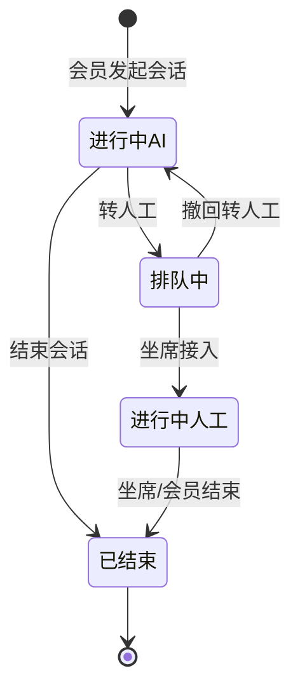
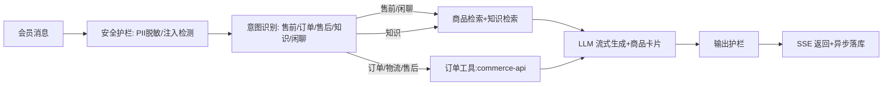

# 产品需求文档 — V3.0 智能客服

| 项 | 值 |
|---|---|
| 产品名称 | 尚品汇（Shang Pivot） |
| 产品版本 | V3.0（依赖：V2.0 出口达标） |
| 文档版本 | V1.0 |
| 文档状态 | Developing |
| 产品负责人 | 产品组 |
| 创建日期 | 2026-11-01 |
| 最后更新 | 2026-11-01 |
| 技术基线 | `docs/03-ai/customer-service-智能客服.md`（§15 AI 需求基线） |

# 1. 产品说明

## 1.1 目的

定义 V3.0 智能客服的功能范围、业务流程、字段规则、交互与验收标准：C 端 AI 对话（导购推荐 / 查单 / 知识问答 / 转人工）+ 管理端坐席与知识库运营。

## 1.2 范围

**包含**：AI 导购推荐（商品卡片）、订单/物流查询、知识库问答（RAG）、快捷问题、转人工、坐席工作台、客服工单、快捷回复、AI 配置、数据看板、安全护栏与审计。

**不包含**：真实物流轨迹对接（V3.0 用沙箱发货数据）、语音输入、主动营销外呼（V4.0 及以后再议）、小程序端（V2.1）。

# 2. 产品概述

## 2.1 背景

V2.0 已交付 C 端交易闭环。购物决策与售前咨询缺乏引导，售后咨询依赖人工。V3.0 按「供给 → 交易 → 服务」路线补齐服务层。

## 2.2 目标

1. C 端会员可通过 AI 对话完成「需求描述 → 商品推荐 → 进详情」链路。
2. 订单/物流类问题可自助查询，减少人工咨询。
3. 知识库运营化：后台维护 FAQ/政策，AI 回答带引用。
4. AI 未解决时可一键转人工，坐席可在后台接入处理。
5. 全程可审计，LLM 故障可降级不阻塞。

## 2.3 出口标准

1. A1~A6 验收锚点全部通过（见 §10.3）。
2. 管理端「智能客服」菜单组可用且受权限控制。
3. LLM 网关不可用时系统降级可用（演示不中断）。

# 3. 用户与角色

## 3.1 角色表

| 角色 | 职责 | 登录方式 |
|---|---|---|
| 会员（C 端） | 与智能客服对话、查单、转人工 | 短信/账号登录（C 端 JWT） |
| 坐席 | 接入转人工会话、回复、转接、结束；处理工单 | 管理端账号（RBAC） |
| 客服管理员 | 知识库/快捷回复维护、坐席管理、看板、AI 配置 | 管理端账号（RBAC） |

## 3.2 权限矩阵

| 功能 | 会员 | 坐席 | 客服管理员 |
|---|---|---|---|
| AI 对话/查单/转人工 | ✓（须登录） | ✓ | ✓ |
| 会话接入/回复/转接 | × | ✓ | ✓ |
| 工单处理 | × | ✓ | ✓ |
| 知识库/快捷回复维护 | × | × | ✓ |
| 坐席管理/看板/AI 配置 | × | × | ✓ |

权限执行：菜单按 RBAC 隐藏；接口按权限码校验；会员只能访问自己的会话与工单，越权返回 403。

# 4. 使用场景

1. **导购**：会员在商城点左下角 AI 球 → 输入「我想买一双 300 元内的跑步鞋」→ 流式回答 + 商品卡片 → 点卡片进详情加购。
2. **查单**：会员问「我的订单到哪了」→ 智能客服调订单工具 → 回复最新订单状态与发货信息。
3. **知识问答**：会员问「退货政策是什么」→ 智能客服检索知识库 → 回答并附来源。
4. **转人工**：会员对回答不满意点「转人工」→ 会话进入排队 → 坐席在管理端接入回复 → 处理完成后结束会话，必要时生成工单跟进。

# 5. 信息架构

## 5.1 页面导航

- C 端（Web/H5）：新增路由 `/ai`（AI 助手对话页）。H5 入口为底部 TabBar 左上方悬浮 AI 头像球；Web 入口为右侧快捷栏「AI 助手」项。
- 管理端：新增一级目录「智能客服」，下挂：会话管理、客服工单、知识库、快捷回复、坐席管理、服务看板。AI 配置并入既有「系统设置」（LLM 分组）。

## 5.2 页面清单

| 页面 | 入口 | 功能 |
|---|---|---|
| AI 助手（C 端 `/ai`） | 悬浮球 / 快捷栏 | 对话、商品卡片、快捷问题、历史会话、转人工 |
| 会话管理 | 管理端菜单 | 待接入/进行中会话、接入、回复、转接、结束 |
| 客服工单 | 管理端菜单 | 工单列表/详情/流转 |
| 知识库 | 管理端菜单 | 文档 CRUD、发布/下架、重建索引、向量化状态 |
| 快捷回复 | 管理端菜单 | 分组与话术 CRUD |
| 坐席管理 | 管理端菜单 | 坐席列表、在线状态、最大并发 |
| 服务看板 | 管理端菜单 | 会话量、转人工率、工单量等统计 |

## 5.3 优先级

P0：AI 助手对话（含推荐卡片）、知识库问答、转人工与会话管理、知识库、AI 配置。P1：工单、快捷回复、坐席管理、看板。P2：满意度评价（延期，目标 V4.0）。

# 6. 业务流程

## 6.1 会话状态机

状态迁移由系统校验：`进行中-ai` 时智能客服自动应答；`排队中/进行中-人工` 时 AI 不应答；`已结束` 只读。

## 6.2 智能客服应答流程

# 7. 功能需求总览

| ID | 模块 | 功能 | 优先级 | 详设 |
|---|---|---|---|---|
| FR-1 | C 端对话 | 会话创建/历史会话列表 | P0 | §8.1 |
| FR-2 | C 端对话 | 消息发送与流式应答（含商品卡片） | P0 | §8.2 |
| FR-3 | C 端对话 | 快捷推荐问题 | P0 | §8.3 |
| FR-4 | C 端对话 | 订单/物流查询 | P0 | §8.4 |
| FR-5 | C 端对话 | 转人工 | P0 | §8.5 |
| FR-6 | 管理端 | 会话管理（接入/回复/转接/结束） | P0 | §8.6 |
| FR-7 | 管理端 | 知识库管理（CRUD/发布/重建索引） | P0 | §8.7 |
| FR-8 | 管理端 | AI 配置 | P0 | §8.8 |
| FR-9 | 管理端 | 客服工单 | P1 | §8.9 |
| FR-10 | 管理端 | 快捷回复 | P1 | §8.10 |
| FR-11 | 管理端 | 坐席管理 | P1 | §8.11 |
| FR-12 | 管理端 | 服务看板 | P1 | §8.12 |
| FR-13 | 平台 | 降级与护栏、审计 | P0 | §8.13 |

# 8. 功能与页面详设

## 8.0 全局交互规范

- 对话消息分三种角色：会员（右侧蓝底）、智能客服（左侧白底，头像用品牌色 AI 标识）、坐席（左侧，标注「人工客服 · 昵称」）。
- 流式期间显示「思考中…」（可展开查看思考摘要），正文逐字上屏；完成后渲染商品卡片。
- 商品卡片：图、名称、副标题、价格（最低~最高）、销量；点击进商品详情；卡片数据一律来自后端 `cards` 事件，前端不拼装。
- 所有页面空态/加载态/错误态齐备；错误给「重试」。

## 8.1 会话（FR-1）

**业务规则**：进入 `/ai` 时若无进行中会话则自动创建（`POST /chat/sessions`），返回 sessionId + 开场白 + 快捷问题；若已有进行中会话（含刷新、从商品详情返回、从站内入口再次进入），自动回放该会话历史消息与商品卡片。最后一条消息（用户或助手）超过 30 分钟未更新时，会话自动置为 `ENDED`，下次进入创建新会话；「历史会话」抽屉列出本人会话（时间倒序，含摘要），点击加载历史消息并继续（已结束会话只读，可「再开一场」）。「新对话」必须结束当前会话并真正新建，旧会话保留在历史会话中。

## 8.2 消息与流式应答（FR-2）

**输入规则表**：

| 字段 | 必填 | 规则 | 错误提示 |
|---|---|---|---|
| 消息内容 | 是 | 1~500 字符；首尾空白裁剪 | 「请输入 1-500 字」 |
| 敏感词/注入 | - | 命中注入特征的输入照常应答但走护栏 | 不报错 |

**业务规则**：发送后 SSE 流式返回；事件见 §8.0；消息落库（用户消息即时、助手消息完成后）；会话处于 `排队中/进行中-人工/已结束` 时禁止走 AI 应答（提示转人工状态）。

## 8.3 快捷推荐问题（FR-3）

`GET /chat/quick-questions` 返回 4~6 条可点击问题（运营可配于快捷回复/推荐问配置）；点击即作为消息发送。

## 8.4 订单/物流查询（FR-4）

**业务规则**：仅登录会员本人订单；智能客服识别意图后调用订单工具，回复订单状态、金额、发货信息（承运商/单号/轨迹，沙箱数据）；无订单时如实回答「未找到」；一次最多列 3 条最近订单。

## 8.5 转人工（FR-5）

**业务规则**：会话 `进行中-ai` 时可转人工 → `排队中`；排队中可撤回（回到 AI）；坐席接入后为 `进行中-人工`；任一方可结束。转人工后输入框照常发送（消息进会话，坐席可见）。

## 8.6 会话管理（FR-6）

**业务规则**：列表按状态筛选（待接入=排队中 / 进行中-人工 / 已结束）；坐席「接入」领取（乐观锁：仅当仍为排队中）；接入后可回复/转接（转给其他在线坐席）/结束；结束时可填摘要并可生成工单。

## 8.7 知识库管理（FR-7）

**字段规则表（知识文档）**：

| 字段 | 必填 | 规则 | 错误提示 |
|---|---|---|---|
| 标题 | 是 | ≤100 字，同库不重名 | 「标题必填/已存在」 |
| 分类 | 是 | 枚举：售后政策/FAQ/活动规则/商品问答 | 「请选择分类」 |
| 内容 | 是 | ≤20000 字 | 「内容超长」 |
| 状态 | 是 | 草稿/发布；发布需标题+内容合法 | - |

**业务规则**：保存/发布后将 `vectorStatus` 置「待向量化」；「重建索引」触发异步向量化（配置了 embedding 才可向量化，否则保持待向量化并提示）；仅「发布 + 已向量化」切片参与向量检索，未配置 embedding 时发布文档内容参与词法检索。

## 8.8 AI 配置（FR-8）

**字段规则表**：

| 字段 | 必填 | 规则 | 错误提示 |
|---|---|---|---|
| Base URL | 是 | 合法 https(s) URL | 「URL 不合法」 |
| API Key | 是 | 密文展示，可重置 | 「Key 必填」 |
| 模型 | 是 | 非空字符串 | 「模型必填」 |
| Temperature | 是 | 0~1，两位小数 | 「0~1 之间」 |
| 系统提示词 | 是 | ≤4000 字 | 「超长」 |
| Embedding 配置 | 否 | 三项同时填或同时空 | 「Embedding 配置不完整」 |
| 检索模式 | 是 | auto/lexical/vector | - |

保存后提供「连通性测试」按钮（返回模型列表探活结果）。

## 8.9 客服工单（FR-9）

**字段规则表**：

| 字段 | 必填 | 规则 | 错误提示 |
|---|---|---|---|
| 类型 | 是 | 咨询/投诉/退款协助/其他 | 「请选择类型」 |
| 标题 | 是 | ≤100 字 | 「标题必填」 |
| 关联会话 | 否 | 从会话创建时自动带出 | - |
| 备注 | 否 | ≤500 字 | 「备注超长」 |

状态机：`待处理 → 处理中 → 已解决`（可退回待处理）；SLA 仅展示计时（超时高亮，不做自动升级）。

## 8.10 快捷回复（FR-10）

分组（名称 ≤50 字）+ 话术（标题 ≤50 字、内容 ≤500 字、排序 int）；坐席回复时点选即填充输入框。

## 8.11 坐席管理（FR-11）

坐席 = 管理端用户映射（`adminUserId`）；字段：在线状态（在线/忙/离线）、最大并发（1~20，默认 5）；「接入」校验当前并发未超限。

## 8.12 服务看板（FR-12）

今日/近 7 日：会话总数、AI 应答数、转人工数与转人工率、人工会话平均时长、工单新增/解决数。数据来自 `customerservice` 表聚合，5 分钟内刷新可接受。

## 8.13 降级与护栏、审计（FR-13）

- 降级：LLM 连续失败或超时 → 回复兜底话术 + 快捷回复 + 词法推荐；前端展示「智能助手暂时繁忙」。
- 护栏：输入注入检测（覆盖系统指令类话术不计入对话上下文的系统层）；输出不泄露系统提示词；手机号在展示层脱敏。
- 审计：会话/消息/工具调用/转人工/工单操作全量入 `customerservice.audit_log`（事件、风险等级、详情 JSON）。

# 9. 非功能需求

1. 流式首字（含思考阶段提示）体验：连接建立 <2s；正文首字目标 <8s（思考型模型），超时走降级。
2. 会话消息持久化不阻塞流式返回。
3. 会员越权访问他人会话返回 403 并审计。
4. 管理端页面首屏 <2s（本地演示环境）。
5. 兼容：C 端 Web（1280+）与 H5（375~）双端可用。

# 10. 边界用例与验收

## 10.1 边界用例

| 场景 | 期望 |
|---|---|
| 未登录访问 `/ai` | 拉起登录层，登录后回到对话页 |
| 发空消息/纯空格 | 前端拦截，不发请求 |
| 500 字以上消息 | 前端限制输入；直连接口返回参数错误 |
| LLM 网关不可用 | 降级回复 + 词法推荐，会话不中断 |
| 转人工后继续发消息 | 消息入库并提示已转人工，AI 不应答 |
| 坐席接入竞态（两人同时点） | 仅一人成功，另一人提示「已被接入」 |
| 会员 A 访问会员 B 会话消息 | 403 |
| 知识文档发布但未向量化（无 embedding） | 词法检索可用，卡片提示向量化待配置 |
| 历史会话回放 | 消息顺序与状态正确，已结束只读 |
| 商品下架后被推荐 | 推荐仅来自在售快照，卡片进详情有兜底页 |

## 10.2 验收矩阵

| AC | 验收项 | 预期结果 | 关联 FR |
|---|---|---|---|
| A1 | 导购链路 | H5 登录→悬浮球→「我想买跑步鞋」→流式回答+真实商品卡片→进详情 | FR-1/2/3 |
| A2 | 查单链路 | 问订单状态返回本人真实订单/发货信息 | FR-4 |
| A3 | 知识问答 | 发布 FAQ→重建→回答附引用 | FR-7 |
| A4 | 转人工闭环 | C 端转人工→坐席接入→双向消息→结束 | FR-5/6 |
| A5 | 降级 | 停用 LLM 后仍可对话（兜底+词法推荐） | FR-13 |
| A6 | 看板与审计 | 看板出数；audit_log 有记录 | FR-12/13 |

## 10.3 出口 Checklist

- [ ] A1~A6 全部通过
- [ ] 管理端「智能客服」菜单组按权限可见
- [ ] LLM 故障降级演练通过
- [ ] V1/V2 文档与原型零改动（版本纪律检查）

# 11. 里程碑

- M3.1：文档与基座（迁移/LLM 客户端/配置）
- M3.2：C 端导购闭环（A1）
- M3.3：订单域工具（A2）
- M3.4：知识库 RAG（A3）
- M3.5：转人工与坐席（A4）
- M3.6：工单/看板/护栏（A5、A6）

# 12. 变更记录

| 版本 | 日期 | 修改人 | 内容 |
|---|---|---|---|
| V1.0 | 2026-11-01 | 产品组 | 首版，依据需求澄清会话定稿 |

# 13. V3.1 增量需求（Agent 运行时，2026-11-07）

> 本文原为 V3.0 范围；V3.1 只增量、不推翻 V3.0 的会话/转人工/知识库/看板能力。

## 13.1 目标

- 把单编排器拆成 Supervisor + 4 个有边界的 LLM 子 Agent + Handoff 规则节点。
- 所有工具经 Tool Gateway 执行：子 Agent 白名单、必填参数、读 1s/写 3s 超时、写风险闸门、trace。
- 高风险写操作（取消订单/确认收货/售后）必须用户确认；低风险加购可配置直执行。
- 每次运行可追溯：`agent_run / agent_step / llm_call / tool_call / retrieval`。
- 保持 V3.0 为默认路径，`AGENT_ENGINE=graph` 灰度切换，可一键回滚。

## 13.2 功能需求

| 编号 | 需求 | 验收 |
|---|---|---|
| FR-14 | Supervisor 路由到导购/订单/售后/知识 | 四类问题命中正确 Agent；转人工命中 Handoff |
| FR-15 | Tool Gateway 统一执行 | 越权/缺参/超时/未确认写均被拒绝并留痕 |
| FR-16 | 写操作确认 | 确认前无写工具；确认后 exactly-once；取消/过期不执行 |
| FR-17 | 运行轨迹 | 管理端按 run 查步骤/模型/工具/检索/token；100% 运行有 trace |
| FR-18 | 兼容与回滚 | legacy 仍可用；`AGENT_ENGINE=legacy` 重启即回滚 |
| FR-19 | 转人工策略 | 显式请求/投诉/负面情绪自动 QUEUED，不额外调 LLM |

## 13.3 非功能

- 首字 P95 ≤3s；图编排额外开销 ≤300ms；读工具 P95 ≤1s，写工具 P95 ≤3s。
- 写操作未确认执行数 = 0；跨顾客越权 = 0。
- Trace 正文截断 4KB + PII 掩码；管理端仅授权角色可见。
- V25/V26 只新增表/菜单，不修改 V3.0 已有表结构。

## 13.4 验收矩阵（V3.1）

| 编号 | 场景 | 期望 |
|---|---|---|
| A7 | 导购 | `searchProducts` + 真实卡片，无编造 |
| A8 | 规格/库存 | `getStock` + 真实 SKU/库存 |
| A9 | 加购 | `addToCart` 数量正确；重复消息不重复加 |
| A10 | 取消订单 | `action` 卡片 → 确认 → `cancelOrder` 一次；取消/过期不执行 |
| A11 | 越权 | 他人订单返回未找到，不生成 pending_action |
| A12 | 转人工 | 显式/投诉 → QUEUED，无工具调用 |
| A13 | 回滚 | `AGENT_ENGINE=legacy` 后 V3.0 Golden 20 条不回归 |
